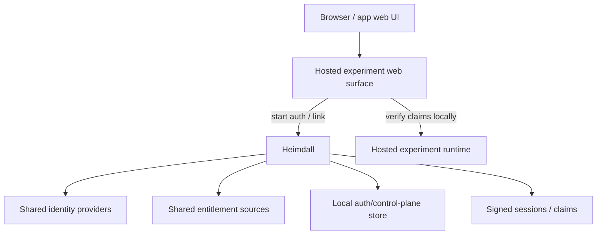

# Heimdall Architecture

## What this file is

This file is the shared architecture note for Heimdall, GameCult's auth
authority service for hosted experiments.

Its basic promise is:

- let people sign in through app-relevant providers such as Discord, Patreon,
  GitHub, Twitch, or YouTube
- decide access from provider entitlements, local grants, and per-app policy
- issue signed local claims that hosted apps can verify without trusting raw
  provider tokens

Implementation and live-release detail belongs in the handoff and evidence
ledger; this file owns the authority model.

## Problem

If every experiment rebuilds:

- provider OAuth
- identity linking
- entitlement refresh
- session cookies
- grant handling
- provider-specific gate logic

then we get five near-identical auth pits and deserve what happens next.

The reusable move is to build one Heimdall authority service and let each app
bind its own policy and runtime seams onto it.

## Design goals

- one reusable local account/session model across hosted experiments
- provider login and linking owned by one shared authority
- per-app capability policies instead of hard-coded one-off gate checks
- host runtimes consume signed local claims, not raw provider tokens
- routine route auth stays local to the host app after claim verification
- keep app-domain data separate unless there is a deliberate reason to share it
- fit the current GameCult topology: Heimdall on Yggdrasil behind nginx, with
  hosted apps either on the same host or verifying over normal HTTPS/JWKS

## Non-goals

- becoming a general public identity provider
- building multi-tenant SaaS auth machinery
- inventing global billing analytics because we got bored
- forcing app-domain data into a shared auth store
- requiring every guarded route in every app to call Heimdall synchronously

## Core concepts

- `Account`
  one GameCult-local person record independent of external providers
- `LinkedIdentity`
  one external provider identity attached to exactly one local account
- `EntitlementSnapshot`
  cached result from an entitlement source saying whether some claim is
  currently true
- `CapabilityGrant`
  a reusable local grant such as `global_member`, `app_access`, or
  `admin_access`, scoped either globally or to one app
- `AppAccessProfile`
  the per-app binding that names capabilities, relevant identity providers,
  entitlement sources, and policy rules
- `Session`
  signed local app/browser session; the browser gets this, not provider tokens
- `AccessClaim`
  signed app-facing claim set derived from the account, grants, and app policy
- `AuditEvent`
  durable record for login, link, unlink, refresh, denial, and admin overrides
- `AuthAttempt`
  Heimdall-owned, expiring OAuth lifecycle record addressed by an opaque handle;
  browsers may carry the handle but cannot complete or redeem it themselves

## Eve access plugin and private command plane

`gamecult.heimdall.access` is Heimdall's reusable Eve representation boundary.
It projects access gates, identity summaries, and access status, and declares
the `auth.begin`, `auth.complete`, and `auth.logout` capabilities. Its
executable `describe`, `validate`, and `project` ABI cannot grant access or
mutate provider state.

App backends call `heimdall.auth.begin` and `heimdall.auth.complete` over the
loopback CultNet operation service at `127.0.0.1:4101`. Every private request is
bound to the configured app secret, source runtime, operation, expiry, nonce,
and idempotency key. The MessagePack payload is AES-256-GCM encrypted; the full
envelope is HMAC authenticated. Completion claims are returned only inside the
same encrypted app-bound envelope.

The browser adapter stores one opaque attempt handle and follows only HTTPS
navigation receipts whose origin appears in both the plugin advertisement and
the validated receipt. It never receives access or refresh claims. The host app
redeems the handle, verifies the Heimdall claim, and owns its local session.

Heimdall publishes four redacted discovery documents to Odin: provider
advertisement, command boundary, plugin advertisement, and transport profile.
Their record keys are globally unique within Odin's catalog. Odin persists and
returns these documents but does not proxy private auth commands. Consumers
resolve the route through Odin, validate the advertised loopback/HMAC/AES
contract, and talk directly to Heimdall. Claims, completions, provider tokens,
app secrets, and account state never enter Odin or public CultMesh.

## Provider taxonomy

Heimdall should classify outside systems by what role they play, not by whether
their brand name appears somewhere in an app.

- `Identity provider`
  proves who the user is and can supply one `LinkedIdentity`
- `Entitlement source`
  answers whether some access-relevant claim is currently true
- `Managed provider credential`
  a user- or account-authorized third-party credential whose OAuth dance, token
  custody, refresh, and revocation Heimdall can own on behalf of an app
- `Local grant source`
  records app or operator-issued overrides inside Heimdall

Default rule:

- if a future app needs user-facing or account-linked OAuth, Heimdall should
  own the ugly parts by default
- the app should only need to describe what the resulting connection means in
  its own world

One provider can play different roles in different apps:

- Repixelizer can treat Discord and Patreon as both identity and entitlement
  sources
- Bifrost can treat GitHub as identity proof while keeping membership approval,
  roles, and governance state app-local
- StreamPixels can reuse shared viewer identity patterns and even shared
  OAuth/token custody for creator-side Twitch/YouTube connections while keeping
  creator bindings, subscriptions, diagnostics, and runtime plumbing
  StreamPixels-owned

## System shape



The important split:

- Heimdall owns provider OAuth, identity linking, entitlement refresh, signed
  sessions, claims, grants, audit surfaces, and managed provider credential
  custody. It authenticates; it does not issue GameCult identity. Bifrost is
  the identity provider, and the account id Heimdall mints is an authenticator
  handle. Remaining scar: Heimdall still creates that account id on first
  login (`store.createAccount`, `src/app.ts`), which the chat work does not
  need moved
- the host experiment owns its workload, queue, editor, render path, viewer
  profile model, creator model, or other product-specific machinery
- the host experiment also owns which local entity a connection attaches to,
  what permissions it implies, and what runtime behavior consumes it

Do not smear provider logic directly through every host runtime.

## Backbone reuse is not data merging

Using the same auth backbone does **not** mean all hosted experiments should
pour their user data into one communal bucket.

The reusable thing is:

- provider OAuth plumbing
- signed session and claim mechanics
- linked-identity primitives
- entitlement refresh
- capability evaluation
- local grant and audit surfaces

The non-reusable-by-default thing is:

- app-domain user data
- creator data
- audience data
- queue/job payloads
- inventories, scenes, outputs, or other product state

Recommended default:

- shared auth/access **authority**
- separate app databases or at least separate app-owned schemas/tables for
  domain data
- if a shared Heimdall store exists at all, keep it limited to auth/control
  plane truth such as identities, grants, entitlement snapshots, sessions,
  claims metadata, and audit events

Do not let "same auth backbone" quietly mutate into "same user-data swamp."

## Reusable data model

Suggested durable core:

- `accounts`
  - `id`
  - `created_at`
  - `last_seen_at`
  - `display_name`
  - `primary_email` nullable
- `linked_identities`
  - `id`
  - `account_id`
  - `provider`
  - `provider_user_id`
  - `username`
  - `access_token_encrypted`
  - `refresh_token_encrypted`
  - `token_expires_at`
  - `profile_json`
  - unique on `(provider, provider_user_id)`
- `entitlement_snapshots`
  - `id`
  - `account_id`
  - `provider`
  - `scope`
  - `evaluated_at`
  - `is_allowed`
  - `reason_code`
  - `reason_detail`
  - `raw_summary_json`
- `capability_grants`
  - `id`
  - `account_id`
  - `scope_type` enum: `global`, `app`
  - `scope_id` nullable app slug
  - `capability`
  - `source` enum: `manual`, `invite`, `migration`, `operator`
  - `status`
  - `expires_at` nullable
  - `note`
- `sessions`
  - `id`
  - `account_id`
  - `app_slug`
  - `created_at`
  - `last_seen_at`
  - `expires_at`
  - `claims_json`
  - `access_revision`
- `audit_events`
  - `id`
  - `account_id` nullable
  - `session_id` nullable
  - `app_slug` nullable
  - `event_type`
  - `event_payload_json`
  - `created_at`

Important invariants:

- one provider identity belongs to one local account only
- provider tokens stay server-side only
- session cookies represent local sessions, not provider trust directly
- app-specific capability checks read signed local claims, not upstream
  providers on every route

## Provider adapters

Shared adapters should be boring and reusable:

- `DiscordIdentityProvider`
  - login via Discord OAuth
- `PatreonIdentityProvider`
  - login via Patreon OAuth
- `GitHubIdentityProvider`
  - login via GitHub OAuth for apps that use GitHub identity as the local
    person-key
- `TwitchIdentityProvider`
  - optional shared login identity when an app wants Twitch-backed sign-in
- `YouTubeIdentityProvider`
  - optional shared login identity when an app wants YouTube-backed sign-in
- `DiscordRoleEntitlementProvider`
  - entitlement check via guild membership and role ids, ideally through the
    GameCult bot token server-side
- `PatreonMembershipEntitlementProvider`
  - entitlement check via campaign membership and tier ids
- `ManualGrantProvider`
  - local override for staff, migrations, experiments, or emergency access
- `InviteGrantProvider`
  - reusable invite-issued app or role grants where that pattern makes sense

Shared connection handling can also cover app integrations when the credential
is user- or account-authorized and worth centralizing:

- Heimdall can own OAuth start/callback, token exchange, encrypted storage,
  refresh, and revocation
- the app still owns binding the connection to a local entity such as
  `creator_id`, `workspace_id`, `project_id`, or `channel_id`
- the app still owns sync jobs, subscriptions, diagnostics, feature toggles,
  and the domain-specific consequences of that connection

Important rule:

- a provider being used anywhere in an app does not automatically make all uses
  of that provider Heimdall-owned
- provider OAuth and token custody should default to Heimdall when the
  connection is tied to a user or account rather than a purely app-local secret
- app-specific binding semantics and runtime behavior still stay app-owned

## Managed credential custody

Source-grounded as of branch `eureka/joystick-h1` at 6db84bf (PR
GameCult/Heimdall#1, unmerged). Nothing here is deployed.

### One owner: `refreshManagedCredential`

`src/managed-credential.ts` owns every decision to present a stored refresh
token to a provider. The entitlement path (`refreshAppSession`), the Bifrost
Patreon sync and `managed-credentials/resolve` all call it; none of them reads
`tokenExpiresAt` or a provider token endpoint itself. The earlier
`refreshLinkedIdentityCredentialIfNeeded` is deleted, and callers no longer
write refreshed tokens through `upsertLinkedIdentity`: a refresh reaches the row
only through the store port below. The only other writer of credential columns
is the OAuth callback's grant write (`app.ts`, once).

| | |
|---|---|
| Input | a `StoredLinkedIdentity` snapshot, the config, the token custody (AES-256-GCM seal), the provider runtimes, an injectable clock and timeout |
| Output | `{kind: "current" or "revoked", identity}`, or a thrown `ManagedCredentialRefreshFailed` (carries the provider and nothing the provider said) |
| Forbidden writers | any caller writing token columns or `token_expires_at` outside `updateLinkedIdentityCredential` and the callback's grant write; any caller computing "is a refresh due" |

The snapshot is a hint. It may answer without a lock when the identity holds no
access token (`revoked`) or no refresh is due (`current`; due means a known
expiry within 5 minutes, a stored refresh token, and a runtime that refreshes).
It never decides that a refresh happens.

### Three nested guards

1. **Single flight, per process.** `refreshesInFlight` is keyed by store, then
   linked identity id. A caller arriving while an attempt is in flight joins it
   and receives its outcome, success or failure, so nobody queues behind a
   failed holder and re-presents the same token. The entry ends with the
   attempt; a later request retries.
2. **Store-port lock, across processes.**
   `HeimdallStore.updateLinkedIdentityCredential(id, decide)` runs `decide`
   against the row as read under the lock. `PostgresStore` takes
   `SELECT ... FOR UPDATE` inside a transaction; `InMemoryStore` serialises per
   id on a promise chain that deletes its entry only when it is still the tail.
   `decide` re-checks `dueForRefresh` on the locked row, so a process that
   waited finds the token already rotated and returns `keep`. The provider call
   is aborted at 10 seconds (`MANAGED_CREDENTIAL_REFRESH_TIMEOUT_MS`), which
   bounds how long any waiter holds a pooled connection.
3. **Decision, not mutation.** `decide` returns a `CredentialDecision`: `keep`,
   `revoke`, or `rotate` with the access token, refresh token and
   `tokenExpiresAt` all required. The store applies it and returns the row. The
   new pair is persisted before the access token is returned. A store that
   keeps the old expiry on rotate is a type error, not a test.

### Typed answers

- **Revoked** (`410 managed_credential_revoked`, audit
  `managed_credential_revoked {provider, reason}`, all three token columns
  cleared). Two reasons only: `provider_revoked`, an HTTP 400 whose OAuth
  `error` is exactly `invalid_grant`; and `rotation_missing`, a well-formed
  refresh answer without a refresh token from a provider whose descriptor says
  `rotatesRefreshTokens`. An identity with no access token is also `revoked`.
  `404` means no linked identity exists. On the entitlement path a revoked
  identity is skipped; on the Bifrost sync it is `404
  patreon_identity_not_linked` with Bifrost uncalled.
- **Refresh failed** (`502 managed_credential_refresh_failed`, tokens
  untouched, retry allowed): invalid client, a 401 or 5xx whatever its body,
  timeout, a 2xx without a string `access_token` or carrying `error`, a
  `refresh_token` present but not a string, an empty or non-JSON body.
  `ProviderResponseError.oauthError` is drawn only from the closed RFC 6749 code
  set and is read only from a 400; no provider body reaches a message, stack or
  audit payload.
- An empty-string `refresh_token` counts as missing.

### Provider descriptor and the one token request

`providerCatalog` (`src/providers.ts`) is the only place a provider's token
behaviour is written down. Fields beyond the authorize side:

- `tokenEndpoint`: where both grants go.
- `tokenEndpointAuthMethod`: `client_secret_basic` or `client_secret_post`
  (RFC 7591 names); exactly one client-auth method per request.
- `rotatesRefreshTokens`: true only for Joystick. Drives fail-closed on
  refresh (`rotation_missing`) and a failed callback on exchange when the grant
  carries no refresh token.
- `defaultAccessTokenLifetimeSeconds`: 3600 for all seven providers. Applied
  when an answer has no usable `expires_in`; unusable means absent, non-numeric,
  not a positive number or positive-integer string, or above 365 days. An
  unknown expiry is therefore never stored, so every credential comes due.

`requestProviderTokens(provider, config, grant)` in `src/oauth.ts` replaces the
ten per-provider exchange and refresh functions. Authorization-code and refresh
grants share it, it returns an `ExpiringTokenSet` (`expiresAt` required), and it
rejects a malformed 2xx typed as `provider_body_not_token_set` on both grants.
The per-provider runtimes keep only identity resolution.

### Mode x role at the gates

`src/app-profiles.ts` holds both questions, and the profile's role lists are
their only input:

- `admitsProviderForMode(profile, provider, mode)`, the start gate: `sign_in`
  and `link` take `identityProviders` only; `connect` takes
  `managedConnectionProviders` or `identityProviders` (Bifrost connects its
  identity providers). `supportsProvider` is deleted.
- `callbackMint(profile, provider, mode, connection)`, decided at the callback
  from the signed state and asked again at start, so an unbound connect never
  reaches a redirect:
  - `viewer_session`: the provider is in `identityProviders`; a normal session
    with the profile's capabilities.
  - `custody_only`: a `connect` for a provider that is only a managed
    connection (Joystick on StreamPixels) with `connection.kind = "creator"` and
    a non-empty `targetId`.
  - `refused`: everything else, before the code exchange.

A custody-only completion stores the credential and issues a claim with no
facts, no capabilities and no hybrid capabilities (`withoutCapabilities` in
`src/claims.ts`, the one owner of a capability-free claim). The completion
payload and the `backend_callback` handoff carry no `refreshToken` or
`refresh`, because the refresh route recomputes facts from the account and would
turn that session into a viewer session. A session row still exists, and
`BackendHandoffSuccessPayload` types both fields optional for this reason. The
consumer's redeem reads only account id, provider, mode, connection and claim
identities, so the claim form is unchanged for it.

### Verification layer

The rules above are pinned by `tests/managed-credential.test.ts` on three rigs
(memory, Postgres with one app, Postgres with two pools),
`tests/provider-token-request.test.ts`, `tests/app.test.ts` (a matrix over all
profiles x providers x modes, callback mint, handoff strip) and
`tests/recipe-secrets.test.ts`. Evidence is the Yggdrasil `ygg-verify` run on
Linux (node:24, postgres:16, `HEIMDALL_REQUIRE_LIVE_PG=1`; 600 passed, 8
skipped, none a live-Postgres suite), hand and StrykerJS mutants over the diff,
and Soul's pass 4 verdict `joystick:verdict:cut-h1.s4`. The deploy path's own
builder was not used.

### Open follow-ups

- `joystick:follow_up:cross-process-failed-refresh-marker`: single flight is per
  process, so N Heimdall processes can present one token N times after a
  transient failure. Needs a failed-attempt marker on the row, read under the
  lock. Must land before or with Idunn onboarding.
- `joystick:follow_up:connect-start-needs-app-auth`: connect starts are
  unauthenticated, so anyone can name `{creator, targetId}`; the callback
  re-check proves a binding exists, not that the caller owns it. It also owns
  the whitespace-only `targetId` that passes both gates and the callback's
  fail-open `''` fallback for a vanished profile (finding
  `joystick:finding:cut-h1.s4.whitespace-targetid-passes-custody-gate`). Must
  land before the public Joystick bot or a second creator.
- `joystick:follow_up:heimdall-idunn-onboarding` (gamecult-ops): live Heimdall
  is a hand-copied release under `heimdall.service`, not an Idunn-admitted
  generation; the recipe's Joystick lines are declared but unproven by a
  deploy.
- `joystick:follow_up:joystick-viewer-signin-public-bot`: Joystick stays out of
  StreamPixels `identityProviders` until the public bot is registered; viewer
  sign-in must not rewrite a creator's credential row.

## Policy model

The shared authority should not hard-code one app's access rules. It should
evaluate capabilities against an app profile.

Suggested app-profile shape:

```text
AppAccessProfile {
  appSlug: string
  displayName: string
  capabilities: string[]
  policyRules: CapabilityRule[]
  publicRoutes: string[]
  explanationStrings: map[string]string
}
```

Example rule style:

```text
app_access   = entitlement.app_access || grant.global_member || grant.app_access
queue_submit = app_access
admin_access = grant.operator || grant.admin_access
```

The important part is not naming a provider in every rule. It is that app
profiles choose which identity facts, app-facing entitlement facts, snapshots,
and local grants feed each capability.

Preferred fact-vocabulary rule:

- signed claim facts should prefer app-facing names such as
  `entitlement.app_access`
- provider-specific evidence such as Discord role ids or Patreon tiers should
  usually stay in entitlement snapshots and linked-identity metadata unless a
  consumer truly needs that exact upstream detail in the claim

## Request path discipline

This is where shared authority stays useful instead of becoming a nuisance.

Heimdall should be in the loop for:

- OAuth start and callback flows
- explicit identity linking and unlinking
- session issuance and refresh
- entitlement refresh
- grant administration
- occasional explicit introspection or revocation checks

Host apps should stay in the loop for:

- routine route authorization after claim verification
- resource ownership checks
- domain-specific permission decisions that depend on app-local data

Normal guarded routes should **not** need to round-trip to Heimdall every time.

## Auth and linking flow

The generic flow should be the same across hosted experiments:

1. user starts OAuth from the host app UI
2. host app redirects to Heimdall or calls Heimdall to begin the flow
3. Heimdall signs OAuth `state`
4. provider callback resolves the provider identity through Heimdall
5. Heimdall finds or creates the local account
6. if the user was already signed in locally, the identity may link onto the
   existing account instead of creating a new one
7. Heimdall refreshes entitlements and capability claims
8. Heimdall issues or updates the local session / claim artifacts consumed by
   the host app

The browser should never be the custodian of provider tokens.

Preferred same-host or Yggdrasil-reachable handoff for hosted apps:

1. the app keeps its main page open
2. auth starts in a script-opened new browser context
3. Heimdall callback completes the provider flow server-side
4. Heimdall delivers the auth result directly to the host app backend over an
   internal backend channel
5. the host app backend establishes the app's local trusted auth state
6. the callback page only needs to signal completion status, try to close
   itself, and offer a dead-simple return path

Recommended browser role in that flow:

- the main app page tracks its own auth attempt locally
- the main app page learns completion from its own backend by polling, SSE, or
  websocket
- the browser should not be the primary carrier of the final auth result

Fallback flow for looser integrations:

- Heimdall can still mint a short-lived one-time completion artifact
- the callback page can `postMessage` that artifact to the opener
- the host app backend can redeem it with Heimdall
- keep this as the portable escape hatch, not the preferred same-host path

This keeps the real auth handoff on the server side while still giving the
user the familiar "log in over there, keep working over here" flow.

## App integration contract

Every hosted experiment should integrate through the same seams:

- define an `app_slug`
- define the app capability profile
- verify Heimdall-issued claims locally
- mark which routes are public, authenticated, or capability-gated
- attach `account_id`, `session_id`, and `access_revision` to owned resources
  such as jobs, drafts, uploads, or queue entries
- if the app uses Heimdall-managed provider connections, bind those connections
  onto app-local entities and keep the downstream runtime behavior local
- require resource-owner checks on private read/update/delete paths

If an app has a queue or job system:

- queue entries belong to local account/session ids, not provider ids
- entitlement refresh should block new submissions after access loss
- active-job cancellation policy is app-specific, but the recommended first cut
  is still "let the active job finish, block new work"

## Deployment topology

Current intended first deployment shape:

- Heimdall runs on `yggdrasil.gamecult.org`
- Heimdall binds a localhost port behind nginx
- public auth hostname is expected to become `heimdall.gamecult.org`
- same-host app stacks such as StreamPixels and Repixelizer call Heimdall over
  localhost or normal private routing when they need auth-authority work done
- app backends verify signed claims locally for routine guarded requests

This matches the host pattern already used by other GameCult app workloads.

## Public surface boundary

**Status: proposed, 2026-09-06. Not implemented.**

The topology above already says what should be true — same-host apps reach
Heimdall over localhost or private routing, and app backends verify claims
locally. The nginx vhost never implemented it. `heimdall.gamecult.org.conf` is a
single `location / { proxy_pass http://heimdall_app; }`, so every route Fastify
registers is on the open web. The boundary exists in this document and nowhere
in the running system.

### What actually has to be public

Only the browser-driven OAuth flow:

| Path | Why it must be public |
|---|---|
| `/v1/oauth/{provider}/start` | the app's server calls it, with its app secret where the profile requires one |
| `/v1/oauth/{provider}/launch` | the user's browser goes here first; it sets the binding cookie and redirects to the provider, once per state |
| `/v1/oauth/{provider}/callback` | the provider redirects here; one-shot: it needs the binding cookie and consumes the state |
| `/.well-known/jwks.json` | *nothing external consumes it today* — see below |

Everything else is internal by the design already written down:

| Path | Consumer |
|---|---|
| `/.well-known/heimdall-configuration` | GC apps, mesh-reachable |
| `/v1/apps` | GC apps, mesh-reachable |
| `/healthz` | local probes |

The private command plane is not part of this question. It is
`startCultNetOperationServer` and never touches nginx.

### JWKS: keep it public, deliberately

No OAuth provider fetches it — every adapter in `src/oauth.ts` authenticates
with `client_secret`, not `private_key_jwt`. Every relying party today is
GameCult-owned and mesh-reachable, so nothing outside needs it.

Keep it public anyway. Publishing verification keys is cryptographically
harmless, and the failure mode of hiding it is asymmetric: the first relying
party hosted outside this mesh will be integrated with a standard OIDC library,
and a `jwks_uri` that resolves only on the mesh fails confusingly at integration
time rather than obviously at design time. This is the one endpoint where the
cost of being wrong is higher in the closed direction.

### Discovery and `/v1/apps`: move them internal

These carry no keys and no cryptographic obligation, and they publish a product
inventory. For every app, `serializeAppProfile` emits `slug`, `displayName`,
`profileVersion`, `identityProviders`, `entitlementSources`,
`managedConnectionProviders` and `capabilities`, alongside `supportedProviders`
and their roles. Since the private command plane's record kinds are
`discord_role_access` and `patreon_membership_access`, the entitlement and
monetization model is legible to anyone who fetches it.

Both routes must move together. Trimming the discovery document alone leaves
`/v1/apps` serving the same list.

### Consequence for the nginx vhost

The vhost stops being one `location /` and becomes an explicit allowlist:
`/v1/oauth/`, `/.well-known/jwks.json`, and nothing else by default. A path
added to Fastify should not become public by having been added — that is the
property the current catch-all lacks.

The vhost stays operator-owned and static regardless of who deploys Heimdall,
because `publicBaseUrl` builds the OAuth callback URL that is **registered with
each provider**. That URL cannot move on deploy.

### Finding: the `spotify` provider outlived its consumer

`spotiverse` was the only profile naming `spotify`, and Spotiverse was lost with
the `E:` drive. The profile has since been removed from the registry
(`docs/app-profiles/spotiverse.md` is the restore spec), and
`admitsProviderForMode` refuses a provider no profile lists, so
`/v1/oauth/spotify/start` no longer reaches a handshake.

What survives: the `spotify` catalog entry and runtime, and, wherever an
operator env still holds them, `GC_ACCESS_PROVIDER_SPOTIFY_CLIENT_ID` and
`GC_ACCESS_PROVIDER_SPOTIFY_CLIENT_SECRET_FILE`. A live credential kept for a
consumer that does not exist is the shape that becomes an incident later.
Retire the provider config, or record why Spotiverse is expected back.

## Deployment modes

### Mode 1: Same-host shared access service

Recommended first cut.

- one Heimdall service on Yggdrasil
- each hosted experiment keeps its own runtime and route integration
- each app keeps its own domain-data store
- apps verify signed claims locally after issuance

Why this is the right first cut:

- fits the current host topology
- avoids cross-runtime shared-library nonsense
- keeps OAuth and provider sludge in one place
- keeps routine guarded requests local inside the app

### Mode 2: Multi-host shared access service

Use this when multiple app stacks across hosts still want one shared auth
authority, but the same claim-verification discipline continues.

### Mode 3: Wider cross-app session platform

Only do this when independently deployed apps genuinely need:

- shared cross-app sessions
- central grant administration
- one callback origin for all providers
- enough auth churn that Heimdall is clearly a long-lived platform surface

Do not build this first because it sounds important.

Even in this mode, Heimdall should own auth/control-plane data, not absorb
every app's audience or product data.

## Configuration split

Heimdall reads plain settings from its environment and every secret from a
file. A secret input `NAME` is configured as `NAME_FILE`, the absolute path of
a file holding only that value; under Idunn the binding binds it in
`[workload.secret_files]` to a `root:root 0400` credential. A blank file is
refused at startup, and so is setting both `NAME` and `NAME_FILE`.

Plain settings:

- `GC_ACCESS_BASE_URL=https://heimdall.gamecult.org`
- `GC_ACCESS_ISSUER=https://heimdall.gamecult.org`
- `GC_ACCESS_STORAGE_BACKEND=postgres`
- `GC_ACCESS_SIGNING_PRIVATE_KEY_PATH=/etc/gamecult/heimdall/credentials/signing-key.pem`
- `GC_ACCESS_SIGNING_PRIVATE_KEY_BOOTSTRAP=1`
- `GC_ACCESS_SIGNING_KEY_ID=...`
- `GC_ACCESS_SESSION_TTL_SECONDS=3600`
- `GC_ACCESS_STATE_TTL_SECONDS=600`
- `GC_ACCESS_PROVIDER_{DISCORD,PATREON,GITHUB,TWITCH,YOUTUBE,SPOTIFY,JOYSTICK}_CLIENT_ID=...`
- `GC_ACCESS_APP_{APP_SLUG}_BACKEND_CALLBACK_URLS=...`

Secret files:

- `GC_ACCESS_DATABASE_URL_FILE=/etc/gamecult/heimdall/credentials/GC_ACCESS_DATABASE_URL`
- `GC_ACCESS_TOKEN_ENCRYPTION_KEY_BASE64_FILE=...`
- `GC_ACCESS_PROVIDER_{DISCORD,PATREON,GITHUB,TWITCH,YOUTUBE,SPOTIFY,JOYSTICK}_CLIENT_SECRET_FILE=...`
- `GC_ACCESS_APP_{APP_SLUG}_SHARED_SECRET_FILE=...`
- `GC_ACCESS_BIFROST_PATRON_SUPPORT_SECRET_FILE=...`

`src/config.ts` is the complete list; `deployment/idunn/recipe.toml` declares
the subset an Idunn binding may set.

Only configure the providers Heimdall actually owns for a given deployment.

The signing key is always a file: `GC_ACCESS_SIGNING_PRIVATE_KEY_PATH` names
it, and Heimdall can bootstrap that file on first boot when
`GC_ACCESS_SIGNING_PRIVATE_KEY_BOOTSTRAP=1`. If no path is configured, the current skeleton falls back to an
ephemeral dev signing key. That is acceptable for local iteration and
absolutely not acceptable for real deployment.

Managed provider tokens should be sealed at rest with a stable
`GC_ACCESS_TOKEN_ENCRYPTION_KEY_BASE64_FILE` secret. The current runtime will still
mint an ephemeral dev token key for in-memory local work, but persistent
Postgres deployments should treat a missing token-encryption key as a hard
misconfiguration, not a vibe.

Per-app binding should live in code or profile config, not in cloned provider
env namespaces. App-local binding and runtime config such as creator
associations, webhook subscriptions, sync toggles, or workspace/project
attachment rules should stay under the app's own config/state even when the
underlying OAuth credential is Heimdall-managed.

## Audit Result

The correct reusable seam is:

- one shared identity authority service
- local verification of signed claims by each host app
- thin per-app access profiles and runtime bindings

The incorrect reusable seam is:

- cloning one app's auth blob into every future experiment
- or turning shared auth into shared domain-data soup
- or forcing every guarded app route to make a Heimdall network hop
